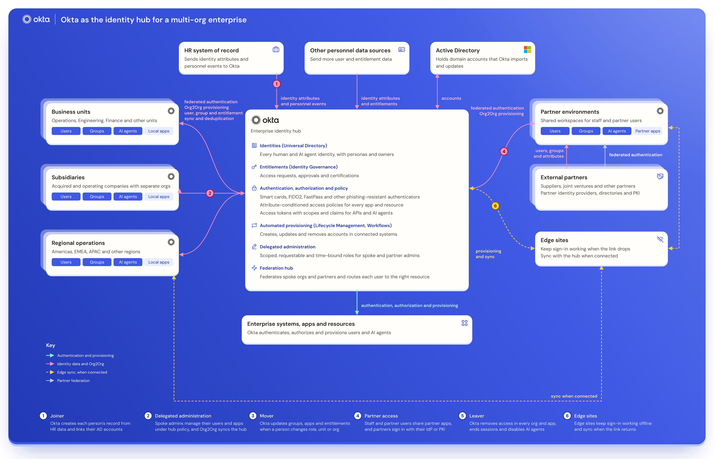

# okta-diagrams

okta-diagrams draws Okta architecture diagrams from a short spec. You describe the cards, lines
and steps in JSON or TypeScript. The tool lays them out, checks the layout and the wording, and
exports a PNG, a 16:9 slide or a PDF.



More examples are in [`examples/`](examples/README.md).

## Install

Follow "Setup" in [`AGENTS.md`](AGENTS.md). It installs the dependencies, the browser for the
layout check, the `okta-diagrams` command and the Claude Code skill.

## Use

```sh
okta-diagrams new docs/diagrams/flow.json     # starts a spec from a template, in any project
okta-diagrams png docs/diagrams/flow.json     # writes flow.png next to the spec
okta-diagrams check docs/diagrams/flow.json   # checks the layout and the wording
okta-diagrams png docs/diagrams/flow.json --slide --theme all   # writes a 16:9 slide in every theme
okta-diagrams help                            # lists every command and option
```

The tool draws PNGs directly with resvg. A headless browser runs only for the layout check and
for PDFs.

In Claude Code, ask for a diagram, such as "draw our SSO flow with okta-diagrams". The
okta-diagrams skill writes the spec, checks it and returns the PNG. For other chat tools, use the
prompt in [`docs/prompts/portable.md`](docs/prompts/portable.md).

## Documents

| Document | Covers |
|---|---|
| [`SKILL.md`](.claude/skills/okta-diagrams/SKILL.md) | The workflow for making a diagram, from brief to final review |
| [`docs/DESIGN-SYSTEM.md`](docs/DESIGN-SYSTEM.md) | The terms, tokens, components, layouts and rules, and how to use the library |
| [`docs/STYLE.md`](docs/STYLE.md) | The themes, colours, type, icons and layout, and where each came from |
| [`docs/WRITING.md`](docs/WRITING.md) | How diagram text reads, with rules and a checklist |
| [`AGENTS.md`](AGENTS.md) | Setup, the code layout and the rules for changing the tool |
| [`docs/prompts/`](docs/prompts/) | A brief checklist and a prompt for chat tools |

`okta-diagrams specimen` writes a style reference page for each theme to `out/specimen/`.

## Licence

The code is MIT licensed ([`LICENSE`](LICENSE)). The fonts, icons and trademarks keep their
original licences, listed in [`THIRD-PARTY-NOTICES.md`](THIRD-PARTY-NOTICES.md).

okta-diagrams is an independent project. It is not an Okta product, and Okta, Inc. does not
endorse it.
