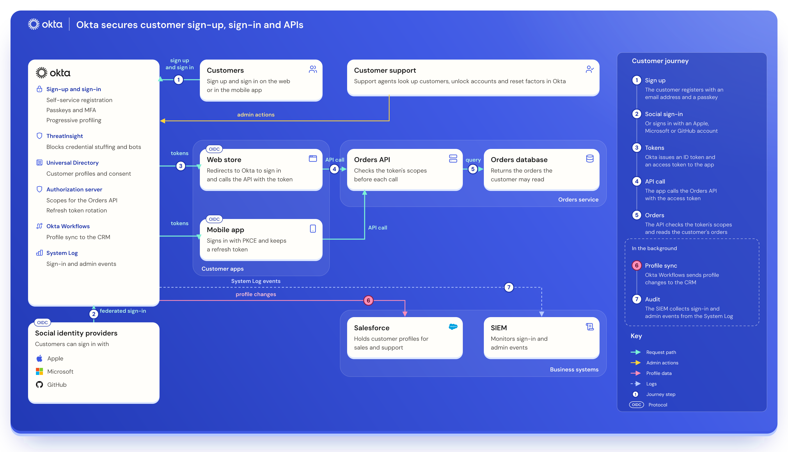
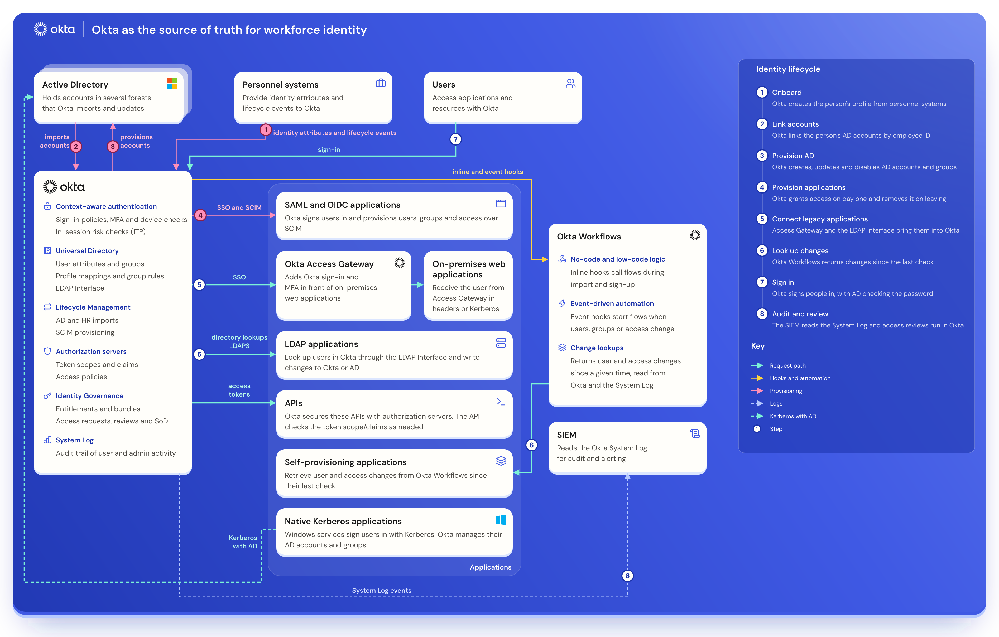
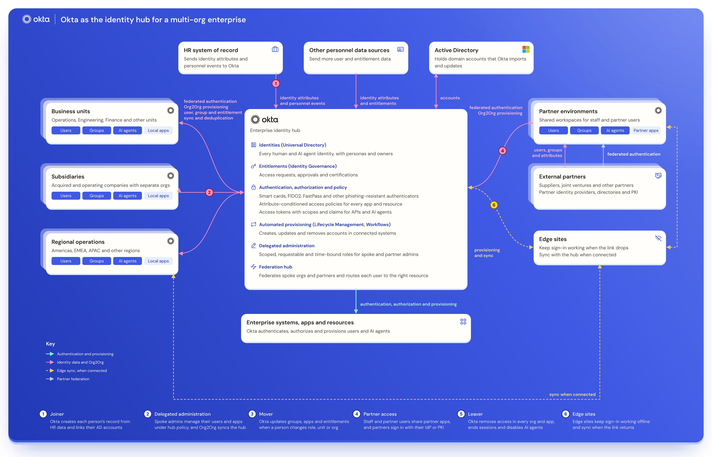
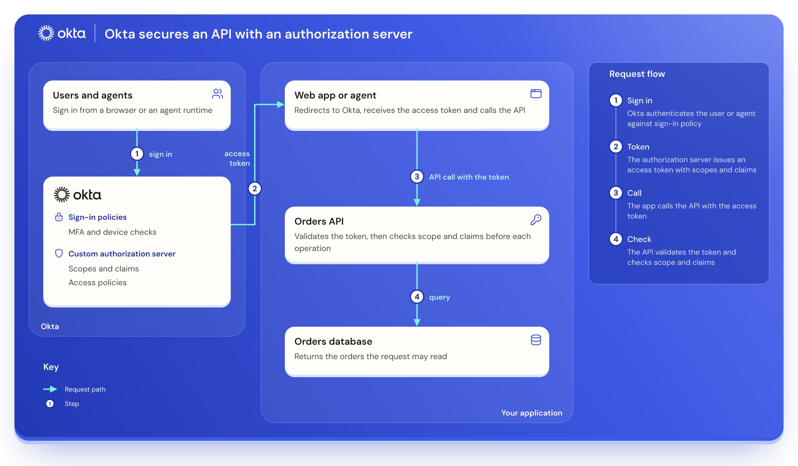
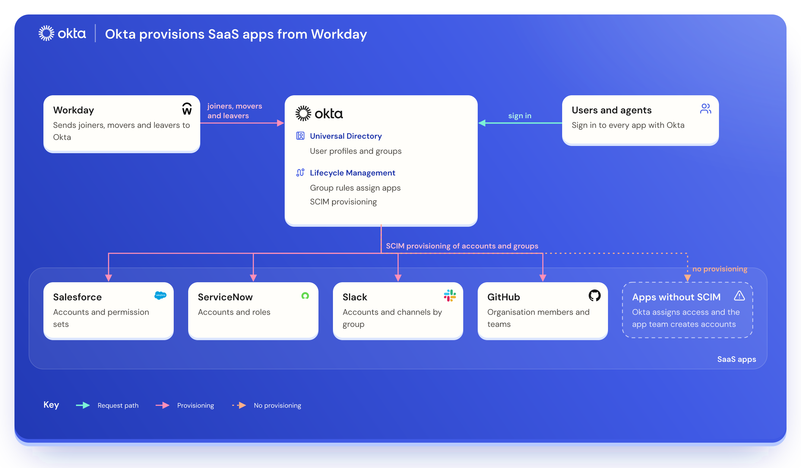
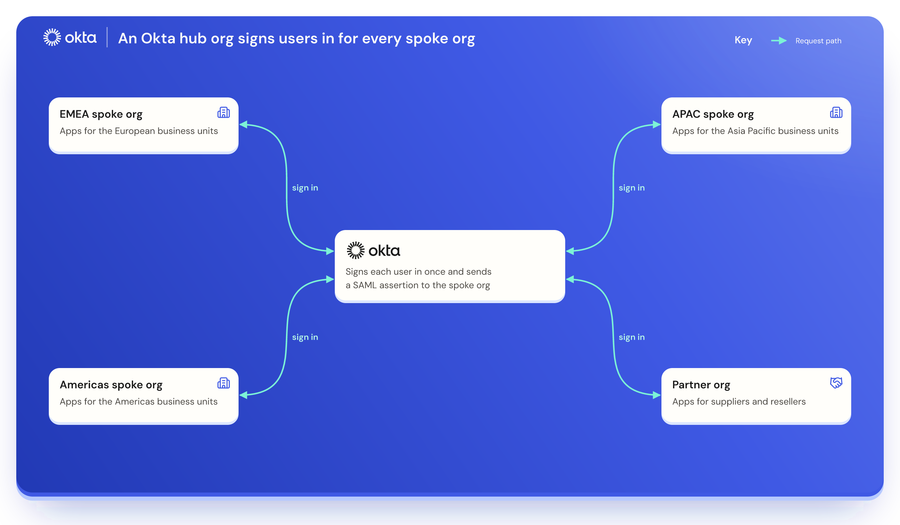
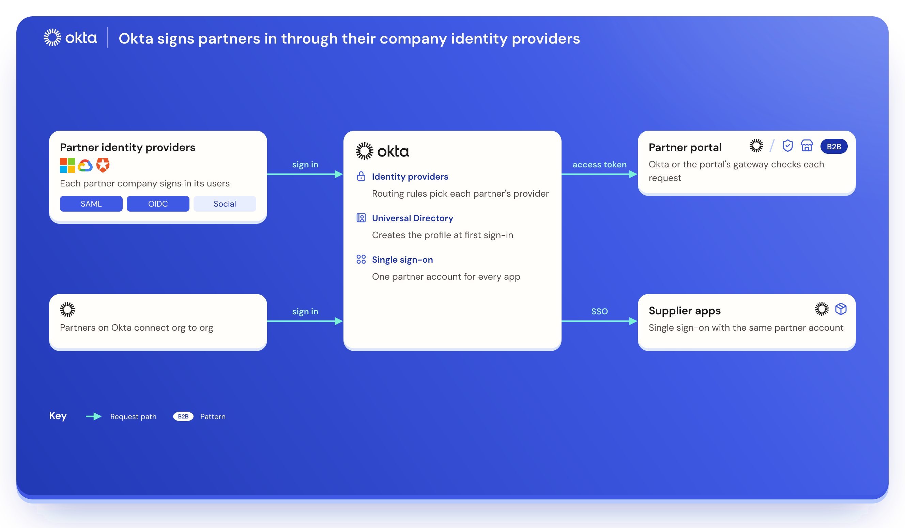

# Examples

Each example is a spec with its PNG beside it. Each is also a regression test:
`okta-diagrams test` renders it in every theme and compares it with `tests/snapshots/`, and
`okta-diagrams verify` redraws the PNGs here. Start a new diagram from one with
`okta-diagrams new <file> --from <example>`.

| Spec | Shows |
|---|---|
| [`customer-identity.json`](customer-identity.json) | Customer sign-up and sign-in, tokens for an API, profile sync and audit: zones, highlight flows, a step group in the side panel |
| [`workforce-identity.json`](workforce-identity.json) | Okta as the source of truth for workforce identity, with every kind of application: a side panel of lifecycle steps |
| [`enterprise-identity-hub.json`](enterprise-identity-hub.json) | One Okta hub for business units, subsidiaries, partners and edge sites: curved lines, stacked cards, steps along the bottom |
| [`token-flow.json`](token-flow.json) | A single flow: an Okta card with sections, numbered steps, a side panel |
| [`scim-provisioning.ts`](scim-provisioning.ts) | A spec written in TypeScript with the placement helpers (`rightOf`, `row`, `zoneAround`), vendor marks, a dashed card, a key in a row |
| [`hub-and-spoke.json`](hub-and-spoke.json) | Curved lines from one hub, mirrored |
| [`card-marks.json`](card-marks.json) | Marks under a card title, badges with a divider, pills, a pattern tag, a card without a title |

## customer-identity

## workforce-identity

## enterprise-identity-hub

## token-flow

## scim-provisioning

## hub-and-spoke

## card-marks

